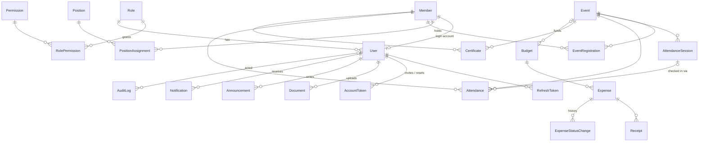

# Architecture

## Overview

```
Browser (React SPA)  ──HTTPS──▶  Express REST API  ──Prisma──▶  PostgreSQL
  - UI, routing, forms            - authentication (JWT + refresh cookie)
  - TanStack Query cache          - authorization (permission middleware)
  - access token in memory        - validation (zod), business rules
                                  - audit logging, file storage
```

- The frontend never talks to the database. Every read and write goes through the API.
- Hiding a button in React is only for convenience. **Every permission is enforced by the API.**
- The system is **single-tenant** (one organization). The `Organization` table holds exactly one row, enforced by a check constraint, with the organization's profile.

## Backend layout

```
backend/
  prisma/
    schema.prisma              data model
    migrations/                SQL migrations (incl. hand-written constraints & triggers)
    seed.ts                    reference data + development demo data
  src/
    app.ts / server.ts         Express app (testable) / process entry point
    routes.ts                  mounts every module; the auth boundary lives here
    config/env.ts              environment variables, validated at startup
    auth/                      permission catalogue, JWT helpers, RBAC sync
    middleware/                authenticate, authorize, error handler, rate limits, uploads
    common/                    errors, pagination, CSV, request helpers
    lib/                       prisma client, logger, storage, money, tokens
    modules/<name>/            one folder per domain module:
        *.routes.ts              HTTP layer: parse input → call service → respond
        *.service.ts             business rules and database access
        *.schemas.ts             zod input schemas
    jobs/                      background jobs (event reminders)
    scripts/bootstrap.ts       deploy-time reference data + first president
  tests/                       integration tests (vitest + supertest, real PostgreSQL)
```

Route handlers stay thin. They validate input with zod, read the caller's identity from `req.auth`, call a service, and shape the response. Services own every rule and every Prisma call. Each service writes its audit entry **in the same transaction** as the change it records.

### Request pipeline

`helmet → CORS allow-list → request log → JSON body (100 KB) → cookies → rate limit → router → authenticate → authorize(permission) → handler → error handler`

The error handler is the only place where errors become HTTP responses:

| Error | Response |
|---|---|
| `AppError` (e.g. `notFound`, `unprocessable`) | its status, code, and safe message |
| `ZodError` | `400 VALIDATION_ERROR` with per-field messages |
| Prisma unique violation / foreign-key violation / not found | `409` / `409` / `404` |
| Anything else | logged, then a generic `500` (internals never leak) |

## Database design



### Key decisions

| Decision | Why |
|---|---|
| **User and Member are separate** (1:1) | A member is an organization record (student ID, course, standing). A user is a login (password hash, role, lockout). Email lives on `Member` only, so there is one source of truth. |
| **No public sign-up; officers invite members** | Membership is controlled by the organization. Invitations and officer-issued password resets share one `AccountToken` table: single use, stored hashed, with an expiry. |
| **Roles are fixed (enum); permissions are data** | Six roles come from the spec. Permission keys live in `Permission` / `RolePermission`, synced from `src/auth/permissions.ts` on every deploy. |
| **Positions are data, separate from roles** | Officers can add "Committee Head" or "PRO" without a migration. `PositionAssignment` keeps the term history. A partial unique index allows only one open term per member. |
| **One attendance row per member per event** | Unique `(eventId, memberId)` makes duplicate check-ins impossible at the database level. `sessionId` is null for system-generated ABSENT rows. |
| **Certificates snapshot names** | `recipientName` / `eventName` are copied at issue time, so a verified certificate keeps saying what it said when it was issued. |
| **Money is `NUMERIC(12,2)` and `Decimal` in code** | Never floats. The API returns amounts as strings (`"12500.00"`) and computes every total on the server. |
| **Expenses are never deleted** | Status history lives in `ExpenseStatusChange`. A trigger blocks deleting or changing the amount of any non-pending expense. |
| **Documents are soft-deleted** | `deletedAt` / `deletedBy` keep the record and file for the audit trail. |
| **Restrictive foreign keys** | Most relations use `ON DELETE RESTRICT`. A member with history cannot be hard-deleted; set them to INACTIVE or ALUMNI instead. |

### Constraints beyond Prisma (in `migrations/*_init/migration.sql`)

- `PositionAssignment_one_open_per_member`: partial unique index on `memberId` where `endDate IS NULL`.
- Check constraints:
  - event capacity > 0
  - event ends after it starts
  - budget and expense amounts > 0
  - year level between 1 and 6
  - `Organization` has a single row
- `AuditLog` and `ExpenseStatusChange` are **append-only**: `UPDATE` and `DELETE` raise an error.
- `Expense_protect_finalized`: a trigger that blocks deleting a finalized expense and blocks changing its amount, budget, category, or date.

### Enums

- `MembershipStatus`: ACTIVE, INACTIVE, ALUMNI
- `UserStatus`: INVITED, ACTIVE, DISABLED
- `EventStatus`: DRAFT, PUBLISHED, ONGOING, COMPLETED, CANCELLED
- `AttendanceStatus`: PRESENT, LATE, ABSENT (with `AttendanceSource`: QR, MANUAL, SYSTEM)
- `ExpenseStatus`: PENDING, APPROVED, REJECTED, REIMBURSED

## Authentication

| Piece | Design |
|---|---|
| Passwords | bcrypt, cost 12. Minimum 10 characters, at least one letter and one number, maximum 72 characters (bcrypt's limit). |
| Access token | JWT (HS256), 15 minutes. It carries **only the user id**. Role and permissions are loaded from the database on each request, so demotions and suspensions take effect immediately. |
| Refresh token | Random 48-byte opaque token, stored **SHA-256 hashed**. Sent as an `httpOnly`, `SameSite=Strict` cookie scoped to `/api/v1/auth`. Lasts 7 days. |
| Rotation | Every refresh issues a new token and revokes the old one. All tokens from one login share a `familyId`. |
| Reuse detection | Presenting a token that was already rotated revokes the whole family and writes an audit entry. A replay within 10 seconds is treated as a two-tab race (`REFRESH_RACE`) and the client just retries. |
| CSRF | Cookie endpoints (`/auth/refresh`, `/auth/logout`) also require `X-Requested-With: XMLHttpRequest`. |
| Brute force | Failed sign-ins are rate-limited per IP + email (10 per 15 minutes), with a looser per-IP ceiling (100) against password spraying. Refreshes are limited per session, not per IP, because students on campus Wi-Fi share one public IP. The account locks for 15 minutes after 5 failed attempts. Unknown emails get the same response and similar timing (a dummy bcrypt compare). |
| Password change | Sets `passwordChangedAt`. Access tokens issued before it are rejected, and all refresh tokens are revoked. |
| Frontend | The access token is kept **in memory only**. On load the app calls `/auth/refresh` to restore the session from the cookie. Concurrent 401s share one refresh, and signing out in one tab signs out every tab (BroadcastChannel). |

## Authorization

Routes declare what they need with `authorize(...permissions)` or `authorizeAny(...)`. Checks that depend on ownership (e.g. "your own certificate", "your own notification") happen in the handler or service, and they always use the id from the token, never an id from the request body.

| Permission | PRES | VP | SEC | TREAS | AUD | MEMBER |
|---|:-:|:-:|:-:|:-:|:-:|:-:|
| members:read | ✓ | ✓ | ✓ | ✓ | ✓ | |
| members:manage | ✓ | ✓ | ✓ | | | |
| positions:manage | ✓ | | | | | |
| roles:assign | ✓ | | | | | |
| events:manage | ✓ | ✓ | ✓ | | | |
| attendance:read | ✓ | ✓ | ✓ | | | |
| attendance:manage | | | ✓ | | | |
| certificates:issue | ✓ | | ✓ | | | |
| finance:read | ✓ | | | ✓ | ✓ | |
| finance:manage | | | | ✓ | | |
| expenses:approve | ✓ | | | | | |
| documents:read | ✓ | ✓ | ✓ | ✓ | ✓ | |
| documents:manage | ✓ | | ✓ | | | |
| announcements:manage | ✓ | ✓ | ✓ | | | |
| reports:read | ✓ | ✓ | | | | |
| audit:read | ✓ | | | | ✓ | |

Every signed-in user can also use the self-service features: view and edit their own profile, register for events and cancel, check in, see their own attendance and certificates, read announcements and member-visible documents, and manage their notifications.

**Built-in business safeguards**

- **Separation of duties:** whoever files an expense cannot approve or reject it. The treasurer files; the president approves.
- **Nobody can change their own role or account status**, and the last active president cannot be demoted or disabled.
- **Only `roles:assign` can issue password-reset links for active accounts**, so a secretary cannot take over the president's account.

## Core workflows

**Event lifecycle.** `DRAFT → PUBLISHED → ONGOING → COMPLETED`, and any non-final state can go to `CANCELLED`. `PUBLISHED → DRAFT` is allowed only while nobody has registered. What each transition does:

- **Cancelling** notifies everyone registered.
- **Completing** closes open check-in sessions and marks registered no-shows `ABSENT` (source SYSTEM).

**Registration.** Allowed only when the event is PUBLISHED, before the deadline, for ACTIVE members. The event row is locked (`SELECT … FOR UPDATE`) while seats are counted, so concurrent registrations can never exceed capacity (covered by a test).

**QR attendance.**

1. The secretary opens a session. A PUBLISHED event becomes ONGOING.
2. The projector page shows a QR code for `APP_URL/check-in?code=<sessionId>.<slot>.<hmac>`.
3. The code is signed with the session's server-side secret and **rotates every 30 seconds**. The server accepts codes up to about 2.5 minutes old, so a forwarded screenshot soon stops working.
4. On check-in, the server verifies the signature and age, the session window, the event state, that the member is ACTIVE and registered, and that they haven't checked in already.
5. The member is marked `PRESENT` or `LATE` depending on `lateAfter` (default: start + 15 minutes).
6. Manual corrections need `attendance:manage` and a written reason, and they are audited.

**Certificates.**

1. Issuing is available only for COMPLETED events, to members marked PRESENT or LATE. Running it twice issues nothing new.
2. Each certificate gets an ID in the form `ITSOC-XXXX-XXXX`, with 40 bits of randomness.
3. The PDF (pdfkit) is generated on demand and embeds a QR code pointing to `/verify/certificate/<id>`.
4. The public endpoint returns only what is printed on the certificate, plus VALID or REVOKED.

**Expenses.**

1. `PENDING` → `APPROVED` or `REJECTED` (a note is required to reject) → (`APPROVED` only) `REIMBURSED`.
2. Approval locks the budget row and refuses to exceed the remaining allocation.
3. Reimbursement requires at least one receipt.
4. Receipts are checked by their actual file contents (magic bytes, not the extension). They can be JPG, PNG, WEBP, or PDF, up to 5 MB, and are served only to users with `finance:read`.

## Files

`lib/storage.ts` is a small storage interface backed by local disk (`UPLOAD_DIR`), and could be replaced by S3 without other changes:

- Keys are generated on the server (`<kind>s/<uuid>.<ext>`) and validated against a pattern when read, which blocks path traversal.
- Files are never served statically. Downloads go through authorized endpoints with a safe `Content-Disposition` header.

## Background jobs

`jobs/event-reminders.ts` runs every 15 minutes and notifies people registered for events starting within 24 hours. Each event is claimed with a conditional update, so several API instances never send duplicate reminders.
